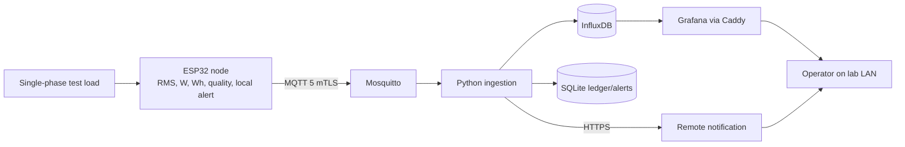

# Intelligent Electrical Energy Monitoring System

Academic IoT prototype (UNMSM, IoT course, Grupo 5). One ESP32 node measures a
controlled single-phase laboratory load, sends telemetry over MQTT, stores it as
time series, shows it in a dashboard, and raises threshold alerts.

This file tracks the project specification, the phases, and the current step.
**Update the status columns and the progress log whenever a step changes.**

> Status legend: ✅ done · 🔄 in progress · ⏳ next · ⬜ not started · ⏸ deferred · ⛔ blocked

---

## 1. Current status

| Item | Value |
|---|---|
| Active feature | `001-energy-monitoring-system` |
| Spec Kit stage | Plan complete. Next: `/speckit.tasks` |
| Implementation | Not started. No source code yet |
| Article | **A2 Introduction drafted** (15 verified references). Next: your review, then A3 outline |
| Last updated | 2026-10-28 |

---

## 2. Project specification summary

The normative sources are in [specs/001-energy-monitoring-system/](specs/001-energy-monitoring-system/).
This section is a summary only. If it disagrees with the spec, the spec wins.

### 2.1 Scope of the first release (MVP)

**In scope**
- One fixed monitoring node, one controlled single-phase lab circuit or isolated test load
- RMS voltage, RMS current, active power (W), active energy (Wh/kWh), with timestamps and quality state
- Near-real-time telemetry, 30-day time-series history, dashboard, node health
- Threshold alerts: a local LED/buzzer plus a remote notification
- Dashboard reachable only from the trusted lab LAN (outbound notifications are allowed)
- Validation against a reference meter (≤1% uncertainty)

**Deferred (out of the MVP)**
- Automatic load disconnection or relay (prohibited in the MVP)
- Temperature/humidity sensing
- Multi-node, three-phase, or billing-grade operation
- Reactive power, apparent power, power-factor claims
- Anomaly detection, forecasting, recommendations
- LoRa and a mobile app

### 2.2 Acceptance targets (success criteria)

| ID | Target |
|---|---|
| SC-001 | V, A, W, Wh within **5%** of the reference meter on ≥3 stable loads |
| SC-002 | **95%** of summaries visible within **10 s**, no silent duplicates (1-hour test) |
| SC-003 | After a 10-min outage, **99%** of queued data recovered in order within **5 min** |
| SC-004 | Local alert in **≤2 s**, remote alert in **≤10 s** |
| SC-005 | A new user finds the peak-consumption hour in a 7-day dataset in **<2 min** |
| SC-006 | Every reading and alert shows its timestamp, unit, and quality/status |

### 2.3 Calibrated measurement range

| Quantity | Range |
|---|---|
| Voltage | 180–250 V RMS, 55–65 Hz |
| Current | 0.25–10.0 A RMS (10 A protection) |
| Active power | 0–2.5 kW |

### 2.4 Technical stack (from the plan)

| Layer | Choice |
|---|---|
| Sensors | SCT-013-020 CT (20 A/1 V); isolated AC adapter (preferred) or ZMPT101B on a reviewed PCB |
| ADC | ADS131M02, 2 simultaneous channels at 4 kS/s |
| Node | ESP32, ESP-IDF 5.4 LTS, C/C++17; FRAM MB85RC256V queue; DS3231 RTC; LED/buzzer |
| Transport | MQTT 5 over mutual TLS (port 8883), QoS 1 plus an application ACK, per-node ACLs |
| Broker | Eclipse Mosquitto 2.1.2 |
| Ingestion | Python 3.14 (Paho, Pydantic, jsonschema, SQLAlchemy/Alembic, FastAPI health), pytest |
| Storage | InfluxDB OSS 2.9.1 (`energy_raw`, `operations`, 30 d); SQLite WAL (ledger, config, alerts, outbox) |
| Dashboard | Grafana OSS 13.2.3 (provisioned) behind Caddy 2 (LAN-only HTTPS) |
| Deployment | One Docker Compose host on the lab LAN, versions pinned (no `latest`) |

### 2.5 Architecture

### 2.6 Specification documents

| Document | Contents |
|---|---|
| [spec.md](specs/001-energy-monitoring-system/spec.md) | User stories, FR-001–FR-017, SC-001–SC-006, edge cases |
| [plan.md](specs/001-energy-monitoring-system/plan.md) | Architecture, hardware, telemetry, security, dashboard, traceability |
| [research.md](specs/001-energy-monitoring-system/research.md) | Decisions R-001–R-011, with sources and rejected alternatives |
| [data-model.md](specs/001-energy-monitoring-system/data-model.md) | Entities, state machines, invariants |
| [contracts/](specs/001-energy-monitoring-system/contracts/) | MQTT v1 JSON Schemas and fixtures |
| [quickstart.md](specs/001-energy-monitoring-system/quickstart.md) | Simulated vertical slice, then supervised hardware acceptance |
| [checklists/requirements.md](specs/001-energy-monitoring-system/checklists/requirements.md) | Spec quality checklist (passed) |
| `.specify/memory/constitution.md` | Project principles v1.0.0 (safety, measurement integrity, MVP-first, security, contracts, reproducibility, resilience) |
| `docs/` (local, git-ignored) | Lab reports 1–6, midterm, `PROJECT_REVIEW.md` |

---

## 3. Spec Kit workflow phases

The command files are in `.speckit/commands/` (see [AGENTS.md](AGENTS.md)).

| # | Phase | Command | Status | Output |
|---|---|---|---|---|
| 1 | Constitution | `/speckit.constitution` | ✅ 2026-10-14 | `.specify/memory/constitution.md` |
| 2 | Specify | `/speckit.specify` | ✅ 2026-10-14 | `spec.md` |
| 3 | Clarify | `/speckit.clarify` | ✅ 2026-10-14 (5 questions resolved) | `spec.md` › Clarifications |
| 4 | Plan | `/speckit.plan` | ✅ 2026-10-14 | `plan.md`, `research.md`, `data-model.md`, `contracts/`, `quickstart.md` |
| 5 | Checklist | `/speckit.checklist` | ✅ requirements · ⬜ others (security, measurement, etc.) | `checklists/` |
| 6 | Tasks | `/speckit.tasks` | ⏳ next | `tasks.md` |
| 7 | Analyze | `/speckit.analyze` | ⬜ | Consistency report for spec, plan, and tasks |
| 8 | Implement | `/speckit.implement` | ⬜ | Source code (see §4) |
| 9 | Converge | `/speckit.converge` | ⬜ | Gap report against the spec |

---

## 4. Implementation milestones

These follow the dependency order required by the plan and the constitution:
simulation and contracts come first, and supervised mains tests come last.

| # | Milestone | Key deliverables | Verification | Status |
|---|---|---|---|---|
| M0 | Repository baseline | Fix `.gitignore`, add `.env.example`, Makefile, lint/secret-scan CI | `make lint`, `make secrets-scan` | ⬜ |
| M1 | Contracts and simulator | JSON Schemas wired into tests, payload simulator | `make contracts-test` | ⬜ |
| M2 | Server stack on simulated data | Compose (Mosquitto, ingestion, InfluxDB, SQLite, Grafana, Caddy), idempotent ledger, dashboard | `make server-test`, `make test-integration` | ⬜ |
| M3 | Firmware calculations | ADC acquisition, RMS/W/Wh, quality flags, FRAM queue, checked against captured waveforms | `make firmware-test` | ⬜ |
| M4 | Safety review and calibration | Signed de-energized review; calibration against the reference meter; separate validation loads | Signed calibration report (SC-001) | ⬜ |
| M5 | End-to-end, recovery, and security | Real node to dashboard, 10-min outage test, mTLS/ACL negative tests, LAN port scan | `make test-recovery`, `make test-security` (SC-002, SC-003) | ⬜ |
| M6 | Thresholds and alerts | Local state machine, server alert lifecycle, notification outbox | State/latency tests (SC-004) | ⬜ |
| M7 | Acceptance | Simulated run, then supervised hardware run, timed operator test | SC-001–SC-006 checklist | ⬜ |
| — | *Future* | Dataset export, anomaly detection, forecasting (each needs its own spec) | — | ⬜ |

### Hardware and lab checklist

- [ ] Components acquired (ESP32, ADS131M02, SCT-013-020, isolated adapter or ZMPT101B, FRAM, DS3231, enclosure, 10 A protection)
- [ ] Reference meter (≤1% uncertainty) available
- [ ] Known loads: low (50–100 W), medium (400–800 W), high (1.5–2.0 kW), plus one inductive or nonlinear load
- [ ] Qualified-person review of schematic, PCB, and enclosure signed **before energizing**

---

## 5. Open issues and decisions

| # | Item | Status |
|---|---|---|
| I-1 | `.gitignore` ignored `.specify`, which conflicts with AGENTS.md. Removed; `.agents` (agent-local skills) stays ignored | ✅ fixed 2026-10-28 |
| I-2 | `docs/` is git-ignored, so lab PDFs are not versioned. Decide whether the article sources belong in `docs/` or elsewhere | ⬜ open |
| I-3 | Final voltage-sensing option (certified adapter vs. ZMPT101B PCB) | ⬜ open |
| I-4 | Remote notification provider not chosen yet | ⬜ open |
| AI-1 | Sensing hardware: the article suggests PZEM-004T; the spec wins (ADS131M02 + SCT-013-020) | ✅ article AD-3 |
| AI-2 | Power factor and frequency: no accuracy claim; mentioned only as limitation and future work | ✅ article AD-4 |
| AI-3 | Analysis scope = the spec's aggregation, peak period, and threshold alerts; anomaly detection is future work | ✅ article AD-5 |
| AI-4 | Target venue: page limit, Letter vs. A4, deadline | ⏸ deferred (IEEE conference defaults for now) |
| AI-5 | Language: Spanish (article AD-2). Authors in `article/metadata.tex`; faculty name and emails to confirm | ✅ 2026-10-28 |
| AI-6 | Measurement uncertainty method (GUM Type A/B) and number of repetitions. Needed before Methodology | ⬜ open |
| AI-7 | Bill of materials and cost, needed for the comparison table (Results) | ⬜ open |
| AI-8 | Literature search: Claude seeds (Scopus/Consensus), Codex runs the search (OpenAlex, Consensus, arXiv, DBLP, web), Claude verifies and drafts | ✅ 2026-10-28 |
| D-1 | Wi-Fi chosen over LoRa (the LoRa figure from Lab 6 is rejected) | ✅ decided |
| D-2 | No relay or automatic cutoff in the MVP | ✅ decided |
| D-3 | Article written in LaTeX with `IEEEtran` (conference) in `article/` | ✅ 2026-10-28 |

---

## 6. Article track

An IEEE paper about the project, written in LaTeX in [article/](article/).

- Requirements: [article/SPEC.md](article/SPEC.md)
- Build, layout, step status, decisions: [article/README.md](article/README.md)

| # | Step | Status | Depends on |
|---|---|---|---|
| A0 | Requirements received; repo setup | ✅ 2026-10-28 | — |
| A1 | Resolve the decisions that block writing (AI-1, AI-2, AI-3, AI-5) | ✅ 2026-10-28 | — |
| A2 | Introduction (literature search plus Section I draft) | ✅ draft 2026-10-28, awaiting your review | A1, AI-8 |
| A3 | Outline and page budget | ⬜ | A2 |
| A4 | Draft Methodology | ⬜ | A3, AI-6 |
| A5 | Results and Discussion | ⬜ | M4–M7 |
| A6 | Conclusions and abstract | ⬜ | A5 |
| A7 | Review and revision | ⬜ | A6 |
| A8 | Submission | ⬜ | A7 |

---

## 7. Progress log

| Date | Phase/step | Change |
|---|---|---|
| 2026-10-14 | Spec Kit 1–5 | Constitution, spec, clarifications, plan, research, data model, contracts, quickstart, requirements checklist |
| 2026-10-28 | Tracking | Created this README to track specification, phases, and article |
| 2026-10-28 | Article A0 | Saved requirements; created `article/` IEEEtran skeleton (builds to a 1-page PDF); listed decisions AI-1–AI-8 |
| 2026-10-28 | Article A1 | Spanish article; spec is the source of truth (AD-2–AD-6); fixed `.gitignore` (I-1); added CLAUDE.md |
| 2026-10-28 | Workflow | CLAUDE.md: briefing (scope, plan, cost estimate, Codex handoff option) required before each step |
| 2026-10-28 | Article A2 | Codex MCP connectors added (OpenAlex, arXiv, DBLP, Consensus); literature handoff launched in background |
| 2026-10-28 | Article A2 | First Codex run interrupted (no outputs). User enabled MCP auto-approve for research connectors; Consensus incompatible with Codex ("Unexpected response type"); relaunched detached with OpenAlex, arXiv, DBLP and web search |
| 2026-10-28 | Article A2 | Codex run 3 finished in ~6 min (12 papers, Peru stats, limitations evidence); Claude verified all DOIs, added Marin 2026 and 2 official statistics, drafted Section I in Spanish; decimal comma (AD-7) |
| 2026-10-28 | Article | Added `article/metadata.tex` (title, 5 authors, affiliation, keywords) |
| 2026-11-04 | Repo | Spec Kit VCS policy: track `specs/`, `.specify/` (minus machine-local files) and `.agents/skills/speckit-*`; ignore other agent folders. AGENTS.md paths fixed. First commits pushed to private GitHub repo `iot-project-unmsm` |
