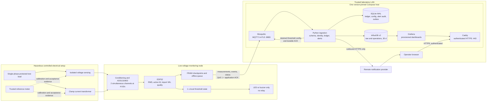

# Implementation Plan: Intelligent Electrical Energy Monitoring System

**Branch**: `001-energy-monitoring-system` | **Date**: 2026-10-14 | **Spec**: [spec.md](spec.md)

**Input**: Feature specification from `specs/001-energy-monitoring-system/spec.md`

## Summary

Build one safe, calibrated ESP32 monitoring node for a protected single-phase
laboratory load and one reproducible LAN server deployment. The node samples
isolated voltage/current channels simultaneously at 4 kS/s, calculates RMS
voltage/current and phase-corrected active power, integrates import energy with a
monotonic clock, evaluates local thresholds, and durably queues five-second
summaries. MQTT 5 with mutual TLS and per-node ACLs carries versioned payloads to
an idempotent Python ingestion service. The service persists 30 days of raw time
series in InfluxDB, discrete delivery/alert state in SQLite, and serves a
provisioned Grafana dashboard through LAN-only HTTPS. Automatic cutoff, LoRa,
environmental sensing, and production anomaly/forecast models are not included.

## Technical Context

**Language/Version**: Firmware C/C++17 with ESP-IDF 5.4 LTS; server Python 3.14.8;
Compose YAML; Flux; JSON Schema Draft 2020-12  
**Primary Dependencies**: ADS131M02 driver, ESP-MQTT/Mbed TLS, ESP-IDF NVS/SNTP/Unity;
Paho MQTT, Pydantic and `jsonschema`, InfluxDB Python client, SQLAlchemy/Alembic,
FastAPI health/management endpoint, pytest; Eclipse Mosquitto 2.1.2, InfluxDB OSS
2.9.1, Grafana OSS 13.2.3, Caddy 2  
**Storage**: Device MB85RC256V FRAM plus encrypted NVS; server InfluxDB `energy_raw`
and `operations` buckets with 30-day retention; SQLite WAL ingestion ledger,
configuration, alert audit, and notification outbox; named container volumes  
**Testing**: ESP-IDF Unity with captured waveforms; pytest/unit/property/contract
tests; JSON Schema fixtures; Docker Compose integration and fault injection;
supervised reference-meter calibration/acceptance; secret scanning and network
reachability tests  
**Target Platform**: ESP32 monitoring node; one x86-64/ARM64 Linux host on the
trusted laboratory LAN; modern browser on the same trusted LAN  
**Project Type**: Embedded firmware plus local services/infrastructure and a
provisioned web dashboard  
**Performance Goals**: 4,000 paired samples/channel/s; 1-second local decision
blocks; one summary/5 seconds; 95% dashboard visibility <=10 seconds; local alert
<=2 seconds and healthy-server alert <=10 seconds; drain recovery queue >=2
records/s; recover >=99% of a 10-minute outage within five minutes  
**Constraints**: Controlled prototype only; calibrated claim limited to 180–250 V
RMS, 0.25–10 A RMS, 0–2.5 kW and tested loads; no relay; qualified safety review
before mains energization; dashboard LAN-only; outbound notifications HTTPS only;
no committed secrets; 16 KiB maximum MQTT payload; at least 256 offline records  
**Scale/Scope**: One node, one circuit, one operator, about 518,400 five-second
records per 30 days, one Compose host, and one outbound notification destination

Exact application packages and container digests MUST be frozen in lockfiles and
the acceptance Compose manifest. No deployment may use an unqualified `latest`
tag. InfluxDB v2 is deliberately selected and must be referenced by exact tag
because its default/latest image line is not a stable v2 contract.

## Constitution Check

### Pre-research gate

| Principle or gate | Status | Planned evidence/control |
|---|---|---|
| I. Electrical Safety Before Convenience | PASS | Isolated sensors, protected range, no relay, de-energized assembly, qualified schematic/PCB/enclosure review, signed safety checklist before hardware test |
| II. Measurement Integrity and Evidence | PASS | Exact quantities/ranges/units and algorithms; <=1% reference meter; separate calibration and validation datasets; per-point <=5% acceptance |
| III. Monitoring MVP Before Optional Complexity | PASS | One-node vertical slice only; LoRa, cutoff, environmental sensing, anomalies, forecasts, and recommendations deferred |
| IV. Security and Secret Hygiene | PASS | Per-principal mTLS/ACLs, encrypted NVS, ignored runtime secrets, private endpoints absent from tracked examples, secret scan gate |
| V. Contract-Tested Boundaries | PASS | ADC fixtures, five JSON Schemas, valid/invalid fixtures, idempotent storage/query and dashboard contract tests |
| VI. Reproducible Experiments and Models | PASS | Versioned calibration evidence and future dataset/experiment manifests; no model influences MVP alerts |
| VII. Resilience and Observability | PASS | FRAM queue, application ACK, deduplication, clock state, restart/outage tests, stage-specific health metrics |
| Dependencies/config/versioning | PASS | Locked firmware/Python/container dependencies; provisioned dashboards, schemas, infrastructure, and calibration/config revisions |

No constitution exception is requested. Unreviewed mains hardware is a release
blocker, not an accepted planning exception.

### Post-design gate

Phase 1 keeps every pre-research gate at **PASS**:

- [research.md](research.md) records decisions, sources, risks, and rejected
  alternatives for safety-relevant and irreversible choices.
- [data-model.md](data-model.md) defines units, quality, identity, lifecycle, and
  persistence invariants.
- [contracts/](contracts/) defines independently testable firmware/service
  boundaries and valid/invalid fixtures.
- [quickstart.md](quickstart.md) starts with simulation and separates unsupervised
  software checks from supervised energized acceptance.
- Analytics collection is designed, but model training/deployment remains a
  separate future specification and cannot block or alter the MVP.

## Project Structure

### Documentation (this feature)

```text
specs/001-energy-monitoring-system/
├── spec.md
├── plan.md
├── research.md
├── data-model.md
├── quickstart.md
├── contracts/
│   ├── README.md
│   ├── measurement.schema.json
│   ├── node-status.schema.json
│   ├── node-event.schema.json
│   ├── threshold-config.schema.json
│   ├── measurement-ack.schema.json
│   └── examples/
│       ├── valid-measurement.json
│       └── invalid-measurement.json
└── tasks.md                 # Created later by $speckit-tasks, not this plan
```

### Source code (repository root, to be created by implementation tasks)

```text
firmware/
├── CMakeLists.txt
├── sdkconfig.defaults
├── main/
├── components/
│   ├── acquisition/
│   ├── calibration/
│   ├── metering/
│   ├── quality/
│   ├── persistence/
│   ├── threshold/
│   └── telemetry/
└── test/

services/
└── ingestion/
    ├── pyproject.toml
    ├── uv.lock
    ├── Dockerfile
    ├── migrations/
    ├── src/energy_ingestion/
    │   ├── contracts/
    │   ├── mqtt/
    │   ├── persistence/
    │   ├── thresholds/
    │   ├── notifications/
    │   ├── health/
    │   └── cli/
    └── tests/

infrastructure/
├── compose.yaml
├── compose.lock.yaml
├── mosquitto/
├── caddy/
├── influxdb/
├── grafana/
│   └── provisioning/
│       ├── datasources/
│       └── dashboards/
└── secrets/
    └── README.example.md

dashboards/
├── energy-overview.json
└── queries/

config/
└── thresholds.example.yaml

experiments/
├── export/
├── manifests/
└── evaluation/

tests/
├── contract/
├── integration/
├── recovery/
├── security/
├── acceptance/
└── fixtures/
    ├── waveforms/
    ├── telemetry/
    └── reference-meter/

docs/
├── architecture/
├── safety/
├── calibration/
├── operations/
└── experiments/
```

**Structure Decision**: Keep hazardous/data-acquisition behavior in `firmware/`,
all server policy in one focused `services/ingestion/` service, deployment state
in `infrastructure/`, and user-visible queries in `dashboards/`. The Phase 1
schemas under this feature directory are the normative contracts; implementation
tests import them rather than maintaining divergent schema copies. `experiments/`
contains dataset export/evaluation tools only, not an MVP analytics service.

Repository setup MUST track `.specify/`, `specs/`, source, infrastructure,
dashboards, example configuration, lockfiles, and procedures. It MUST ignore
`.env*` except `.env.example`, private keys/certificates, local secret directories,
runtime databases/volumes, build outputs, caches, captures containing private
data, and generated experiment data not represented by a checked manifest. The
existing `.gitignore` rule that ignores `.specify` conflicts with repository
instructions and must be corrected in the first repository-baseline task.

## Component and Deployment Design

This figure replaces the conflicting LoRa diagram. Solid arrows are runtime data
or control; dotted arrows are offline evidence. Trust and deployment boundaries
are explicit.



### Deployment boundaries

- **Electrical boundary**: sensing and protection terminate at isolated
  transducers. Mains never reaches ESP32, USB, network, or server wiring. The
  assembled board/enclosure still requires qualified review.
- **Node boundary**: acquisition, calibration, five-second aggregation, energy
  continuity, quality state, local threshold evaluation, clock management, and
  offline queue continue without server availability.
- **Broker boundary**: authenticates identities and enforces topics; it does not
  validate electrical semantics or prove database storage.
- **Ingestion boundary**: validates contract and identity, deduplicates, persists,
  evaluates/audits server alert state, emits notifications, and ACKs durable
  outcomes.
- **Storage/presentation boundary**: InfluxDB contains time series; SQLite contains
  discrete state. Grafana is read-only and receives a least-privilege Influx token.
- **Network boundary**: host publishes only 8883 and 443 to allowlisted lab
  subnets. Broker is restricted to device/host subnets. Databases, service health,
  and native Grafana ports stay on the Compose network. No public inbound route.

## Hardware and Measurement Design

### Front end and pin allocation

- Prefer a certified isolated 220 V-to-low-voltage AC adapter for voltage. If the
  ZMPT101B path is used, its four approximately 27.4 kohm/0.5 W flameproof,
  voltage-rated primary resistors are split across both conductors; the secondary
  uses a 100 ohm burden. Final values and voltage/power derating require schematic
  review and measurement.
- Use SCT-013-020 (20 A/1 V internal burden) around exactly one insulated
  conductor and record its direction.
- ADS131M02 voltage channel PGA 2, current channel PGA 1; 50 ohms per input leg,
  4.7 nF differential anti-alias capacitor, and the manufacturer-recommended
  clamps. SPI CRC failure invalidates the affected window.
- Candidate ESP32 pins: SPI SCLK 18, MISO 19, MOSI 23, CS 27, DRDY input 34; I2C
  SDA 21/SCL 22 for DS3231 and FRAM. The PCB review must confirm the exact module's
  boot straps and electrical limits before layout release.

### Quantities and aggregation

| Field | Exact meaning | Wire unit | Valid calibrated range |
|---|---|---|---|
| `voltage_rms` | Square root of mean squared calibrated instantaneous voltage across a 5 s window | V | 180–250 V RMS |
| `current_rms` | Square root of mean squared calibrated instantaneous current across the same paired window | A | 0.25–10.0 A RMS |
| `active_power` | Mean instantaneous `v*i` after offset, gain, and phase correction; not `Vrms*Irms` | W | 0–2,500 W consumption claim; signed diagnostic value |
| `active_energy_import_total` | Monotonic sum of `max(active_power,0)*monotonic_dt/3600` for one counter continuity ID | Wh | Accuracy claimed only across accepted test intervals |

The firmware maintains 1-second calculation/quality blocks and combines five
blocks into one summary. A nominal summary has 20,000 paired samples. It reports
min/max and internal diagnostic counts locally, but the v1 wire contract carries
the contractually required values, sample count, valid ratio, calibration
revision, and flags. No field claims apparent power, reactive power, power factor,
or billing accuracy.

### Calibration and acceptance procedure

1. Complete and sign a de-energized schematic/layout/enclosure/protection review.
2. Record build revision, firmware commit, ADC settings, sensors, wiring, operator,
   conditions, load identities, and <=1%-uncertainty reference-meter evidence.
3. Warm up at least ten minutes; capture 60 seconds at zero current.
4. Calculate voltage and current gain at stable points and fractional phase
   correction using a stable non-unity-PF load.
5. Write coefficients to a new immutable calibration artifact/NVS revision and
   freeze them before validation.
6. Validate on separate low (50–100 W), medium (400–800 W), high (1.5–2.0 kW)
   resistive loads and one inductive/nonlinear load. Capture >=5 minutes per power
   point and >=15 minutes for Wh.
7. Require every V, A, W, and Wh point to have absolute percentage error <=5%.
   Below-range/no-load current uses an absolute noise limit, not percentage error.
8. Hash and preserve raw waveform excerpts, summaries, reference readings,
   scripts, environment, coefficients, and pass/fail output. Outside-range data is
   flagged and cannot support the claim.

## Telemetry, Delivery, and Clock Design

The normative topics, fields, units, compatibility rules, and schemas are in
[contracts/README.md](contracts/README.md). MQTT 5 runs on TLS port 8883 with QoS
1. The node uses Clean Start false, 24-hour session expiry, 15-second keepalive,
retained offline last will, and stable client ID equal to node identity. The
ingestor uses a stable persistent session. Measurements/events/ACKs have a 24-hour
message expiry; status/config are retained.

The node writes a compact record to FRAM before publication and removes it only
after application `accepted` or `duplicate`. The server records payload hash and
identity in SQLite, performs an idempotent Influx point write using observation
time, marks the ledger stored, then publishes the application ACK. Thus MQTT is
explicitly at least once while the accepted data has an exactly-once storage
effect. A reused ID with different bytes is rejected/quarantined as a conflict.
After reconnect, drain oldest first at >=2 records/s with <=10 in flight while
continuing to enqueue current observations.

SNTP UTC is authoritative; DS3231 supplies holdover after restart. Window `end`
is the observation timestamp. Server adds receive/store times and calculates lag.
Energy uses monotonic time, so SNTP adjustment cannot add/subtract Wh. Queries sort
on observation time, then boot/sequence; they do not mistake arrival order for
physical order. Unsynchronized observations remain diagnostic and cannot be
`valid` evidence.

## Security Design

- Private lab CA with unique node and service leaf certificates. TLS 1.2 minimum;
  validate chain and server name. Disable anonymous MQTT and map certificate
  identity to ACL principal.
- Device ACL: publish only its own measurement/event/status; subscribe only to its
  own config/ACK. Ingestion has the inverse minimum permissions; admin identity is
  separate.
- Wired/trusted provisioning reads an ignored per-device manifest and writes
  credentials into encrypted NVS. Public CA certificates and redacted examples
  may be tracked; private CA key and leaf keys may not.
- Compose secrets mount credentials read-only at runtime. Grafana read,
  ingestion write, and setup/admin Influx tokens are separate. Logs and reject
  records contain hashes/reason codes rather than secret-bearing payload dumps.
- Caddy is the only dashboard ingress. Dashboard has one authenticated operator,
  no anonymous access/self-registration, and no direct browser MQTT connection.
  Host firewall restricts 443/8883 to configured trusted subnets; no public port
  forwarding or UPnP.
- Outbound notifications use HTTPS, a runtime-only token, stable `alert_id` for
  idempotency, bounded retries, and redacted error logs. Provider failure never
  blocks local warning or measurement storage.
- CI/release gates include secret scanning, container/dependency scanning,
  certificate/ACL negative tests, and an external LAN port scan.

## Storage, Dashboard, Alerts, and Health

### Storage and retention

- `energy_raw`: one `electrical_measurement` point/5 seconds, 30-day retention.
  Tags: node, circuit, quality, calibration revision. UUID, boot, sequence, values,
  clock data, flags, and receive lag remain fields to avoid cardinality growth.
- `operations`: status, rejects, duplicate/conflict counts, queue/replay, stage
  health, notification delivery, and latency; 30-day retention.
- Optional reproducible hourly/daily rollups may retain one year. They record
  source interval/query revision and never replace raw records inside 30 days.
- SQLite WAL is backed up with the deployment volumes. Ledger and alert audit
  retain at least one year for the prototype; explicit maintenance handles later
  pruning. Destructive volume/retention commands are separate from normal stop.

### Dashboard panels

1. Identity/quality banner: node, circuit, online/stale/offline, calibration,
   clock, last valid update and age.
2. Current cards: V RMS, A RMS, active W, import Wh/kWh, each with unit,
   timestamp, and quality.
3. Active-power time series with alert and data-gap annotations.
4. Voltage/current time series with calibrated-range bands.
5. Hourly energy bars and daily/weekly totals calculated from valid counter
   differences, never by summing cumulative totals.
6. Measurement quality: invalid/degraded windows, flags, clock state, gaps and
   calibration changes.
7. Alert table/history: evidence, severity, open/acknowledged/resolved state,
   notification state, and transition times.
8. Pipeline health: node heartbeat/queue, MQTT session, accept/reject/duplicate,
   ingest and storage latency/errors, datasource/query health, and dashboard age.

Grafana dashboards/datasources are file-provisioned and read-only. Stale and
offline states replace the current-value presentation; a previous measurement is
never displayed as if live.

### Threshold and alert lifecycle

Thresholds are changed by the authenticated local `energyctl` management command,
which validates a versioned YAML input, stores/audits it, and publishes the latest
retained config. A browser-based configuration editor is not part of the MVP.

Firmware evaluates only valid 1-second blocks:
`normal -> pending -> firing -> clearing -> resolved/normal`. Default confirmation
is ten seconds; clear threshold defaults to 95% of the limit and must remain below
the limit; clear duration prevents flapping. LED/buzzer is active during firing
and clearing. Invalid data pauses electrical confirmation and raises a distinct
quality event—it is not interpreted as zero or safe.

Ingestion turns immutable node events into an audited server alert:
`open -> acknowledged -> resolved`; open may resolve without acknowledgment.
Acknowledgment records operator receipt and does not clear the physical state.
The transactional outbox records notification delivery independently. The server
checks event config/value against stored configuration and nearby measurement;
disagreement becomes a health alert rather than silently changing the result.

### Health observability

- Node: ADC/CRC/sample status, calibration, clock, energy continuity, Wi-Fi/MQTT,
  queue depth/oldest record, last ACK, firmware/build, restart reason.
- Broker: authenticated connections, queued/dropped messages, persistence state.
- Ingestion: received/accepted/rejected/duplicate/conflict, ledger states,
  validation reason, Influx/SQLite latency/error, notification backlog.
- Storage/dashboard: health/readiness, query/write errors, last successful point,
  datasource health, dashboard age.
- Logs are structured UTC JSON with component/event/node/message identity,
  result/reason and latency; never secrets. Internal liveness/readiness endpoints
  are container-only. Status heartbeat is 30 seconds; measurement stale at 15
  seconds; node offline at 30 seconds or authenticated last will.

## Future Dataset and Evaluation Design

The MVP does not train or serve models. Before the raw 30-day expiry, an export
job creates immutable daily Parquet snapshots from accepted measurements and a
manifest with exact query, UTC interval, schema/calibration/firmware revisions,
quality exclusions, controlled-load/reference labels, file hashes, code commit,
and environment-lock hash. Raw snapshot, curated dataset, labels, and split
manifest remain separate; reruns create new versions.

Anomaly experiments split chronologically by complete days/load sessions and
compare against threshold and rolling robust baselines. Held-out metrics are
precision, recall, F1, false alerts/day, and detection delay, stratified by load
and quality. Forecast experiments use rolling-origin evaluation and compare with
last-value and seasonal-naive baselines using MAE, RMSE, WAPE and, if applicable,
prediction-interval coverage. Invalid, clock-uncertain, calibration-change, and
outage-replay intervals follow documented inclusion rules. Insufficient history
produces `insufficient data`, not a model result. A future specification must set
horizons and promotion thresholds before any result affects users.

## Requirement Traceability and Verification

| Requirement/outcome | Design element | Minimum verification evidence |
|---|---|---|
| FR-001–005, SC-001 | Simultaneous ADC, formulas, quality, FRAM, calibration | Waveform unit tests; CRC/gap/restart injection; signed reference-meter report |
| FR-006, SC-002–003 | MQTT QoS 1, durable queue, ledger, app ACK | Duplicate/conflict tests; broker/ingestion/storage stops; timed 10-minute recovery report |
| FR-007 | mTLS, ACL, encrypted provisioning, LAN-only ingress | Anonymous/untrusted/wrong-topic negatives, secret scan, LAN port scan |
| FR-008 | Influx 30-day bucket | Provisioning assertion and retention API test |
| FR-009–010, SC-005–006 | Eight dashboard groups and query rules | Provisioning smoke test, golden queries, timed operator acceptance |
| FR-011–016, SC-004 | Versioned config, local state engine, event/alert/outbox | State transition tests, brief/sustained load tests, server-down local-warning test |
| FR-017 | Stage-specific status/logs/metrics | Fault injected at each stage and correctly identified on health view |
| Future analytics readiness | Immutable exports/manifests/splits/baselines | Reproduction test from manifest; no runtime model in MVP |

The implementation sequence should keep each vertical milestone independently
verifiable: contracts/simulator; server storage/dashboard; firmware calculations;
calibration; end-to-end recovery/security; then thresholds/alerts. Task generation
must preserve that dependency order and place supervised mains tests after all
simulation and low-voltage gates.

## Complexity Tracking

No constitution violations require justification. The second persistence engine
is not a waiver: InfluxDB stores high-volume time series, while embedded SQLite
provides the unique idempotency ledger and transactional alert/outbox state needed
for FR-006 and FR-014. Both remain on one host and behind one ingestion service.
