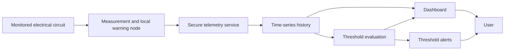

# Feature Specification: Intelligent Electrical Energy Monitoring System

**Feature Branch**: `001-energy-monitoring-system`

**Created**: 2026-10-14

**Status**: Draft

**Input**: Consolidate and revise the project definition contained in the six IoT laboratory documents under `docs/` into one coherent, testable project specification.

## Clarifications

### Session 2026-10-14

- Q: What deployment scope must the first working release support? → A: One controlled single-phase laboratory circuit or isolated test load; not for permanent installation.
- Q: Which electrical quantities must the first release measure and validate? → A: RMS voltage, RMS current, active power in W, and active energy in Wh/kWh.
- Q: Which analytics capabilities must be completed in the first release? → A: Threshold-based local and remote alerts only; anomaly detection, forecasting, and recommendations are later features.
- Q: Which acceptance-threshold profile should the first release be required to pass? → A: Balanced profile: 5% measurement error, 95% of updates within 10 seconds, 99% outage recovery, and local/remote alerts within 2/10 seconds.
- Q: How should the operator be allowed to access the first-release dashboard? → A: Only from a trusted laboratory/local network; outbound remote threshold alerts are allowed.

## User Scenarios & Testing *(mandatory)*

### User Story 1 - Monitor electrical consumption in real time (Priority: P1)

As a laboratory operator or evaluator, I want to see the current electrical behavior of a controlled test circuit so that I can understand how much energy it is using and notice unsafe or wasteful conditions.

**Why this priority**: Reliable measurement and visibility are the minimum useful product. Analytics, alerts, and recommendations have no value until trustworthy telemetry is available.

**Independent Test**: Connect the monitoring node to a controlled single-phase test circuit, apply known loads, and verify that the user can see RMS voltage, RMS current, active power, and accumulated active energy with timestamps and measurement-health information.

**Acceptance Scenarios**:

1. **Given** a calibrated node and an energized test load, **When** the load is switched on, **Then** the latest electrical measurements become visible to the user within 10 seconds.
2. **Given** two different known loads, **When** the second load is added, **Then** the displayed RMS current and active power change consistently with the reference meter.
3. **Given** an invalid or out-of-range sensor reading, **When** the system processes it, **Then** the reading is marked invalid and is not presented as trustworthy consumption data.

---

### User Story 2 - Review consumption history (Priority: P2)

As a user, I want to review consumption by hour, day, and week so that I can identify high-consumption periods and compare usage over time.

**Why this priority**: Historical visibility turns raw telemetry into actionable evidence and provides the data foundation required for anomaly detection and forecasting.

**Independent Test**: Load a representative set of timestamped measurements and verify that the user can select a time range, view trends, and identify the interval with the highest consumption.

**Acceptance Scenarios**:

1. **Given** at least one day of measurements, **When** the user selects an hourly or daily view, **Then** the system shows the corresponding active-power trend and accumulated active energy for that period.
2. **Given** a temporary communications outage, **When** connectivity returns, **Then** recoverable measurements are delivered without being silently duplicated or reordered.

---

### User Story 3 - Receive threshold alerts (Priority: P3)

As a user, I want to be warned when consumption is unusually high or exceeds a configured safety threshold so that I can inspect the connected equipment and reduce waste or risk.

**Why this priority**: Timely alerts are the first direct intervention the project provides and can be validated before advanced predictive models are available.

**Independent Test**: Configure an upper active-power threshold, introduce controlled loads below and above it, and verify local and remote alert behavior without relying on historical data.

**Acceptance Scenarios**:

1. **Given** a configured maximum active-power threshold, **When** the measured active power remains above it for the configured confirmation period, **Then** the system issues an alert identifying the circuit, time, measured value, threshold, and severity.
2. **Given** the remote service is unavailable, **When** a local threshold is exceeded, **Then** the monitoring node still presents a local warning.
3. **Given** a confirmed local threshold violation and healthy remote services, **When** the event is transmitted, **Then** the dashboard records it and the user receives a remote threshold alert.

### Edge Cases

- The monitored circuit is de-energized or draws current below the measurable range.
- A sensor is disconnected, saturated, miscalibrated, or produces noisy readings.
- Voltage and current samples are incomplete or their timestamps cannot be trusted.
- The network, telemetry service, storage service, or dashboard becomes unavailable.
- An unauthorized or public-network client attempts to open the dashboard.
- The monitoring node restarts during an active-energy accumulation interval.
- Duplicate, late, or out-of-order measurements arrive after reconnection.
- Daylight-saving or timezone changes affect daily and weekly aggregation.
- A brief startup surge crosses a threshold but should not create a sustained-consumption alert.
- A user configures an unsafe, nonsensical, or unsupported threshold.

## Scope and System Context

The first release is a controlled, single-node prototype for one single-phase laboratory circuit or isolated test load and is not intended for permanent installation. It proves trustworthy measurement, trusted-network visibility, historical analysis, and alerts before adding optional automation or environmental sensing.

**In scope for the first release**:

- One fixed monitoring node and one controlled single-phase laboratory circuit or isolated test load.
- RMS voltage, RMS current, active power in W, active energy in Wh/kWh, timestamps, and measurement-health data.
- Near-real-time telemetry, durable time-series history, dashboard views, node-health status, and threshold alerts.
- Dashboard access restricted to the trusted laboratory/local network, with outbound remote threshold notifications permitted.
- A local visible or audible warning for configured safety thresholds.
- Evaluation against a reference meter and controlled load changes.

**Deferred until the monitoring MVP is validated**:

- Automatic disconnection or switching of mains-powered loads.
- Temperature and humidity sensing.
- Multi-node, multi-circuit, three-phase, or utility billing-grade operation.
- Apparent power, reactive power, and power-factor claims beyond what is required to validate active power and active energy.
- Historical anomaly detection, forecasting, and automated recommendations.
- Long-range radio connectivity and a dedicated mobile application.

## Requirements *(mandatory)*

### Functional Requirements

- **FR-001**: The system MUST acquire voltage and current observations from one monitored single-phase circuit at a rate sufficient to publish validated RMS voltage, RMS current, and active-power summaries at least every 5 seconds.
- **FR-002**: Every published measurement MUST include a timestamp, node identity, circuit identity, units, and a validity or quality indication.
- **FR-003**: The system MUST calculate and report active power in watts and accumulated active energy in Wh or kWh from synchronized voltage and current observations using a documented phase-correction, calibration, and unit convention; multiplying independent RMS values alone MUST NOT be labeled active power.
- **FR-004**: The system MUST reject, flag, or quarantine disconnected, saturated, physically impossible, stale, or otherwise invalid observations.
- **FR-005**: The system MUST preserve active-energy accumulation across routine restarts and MUST clearly indicate any interval for which accumulation is uncertain.
- **FR-006**: The system MUST transmit validated telemetry to the remote service and retry recoverable failures without silently duplicating measurements.
- **FR-007**: Device and service connections MUST be authenticated, telemetry in transit MUST be protected from unauthorized disclosure or alteration, and secrets MUST not be included in source-controlled files. The dashboard MUST accept access only from the trusted laboratory/local network and MUST NOT be exposed directly to inbound public-internet traffic; outbound remote threshold notifications are permitted.
- **FR-008**: The system MUST retain at least 30 days of timestamped measurements for the prototype evaluation unless storage capacity is explicitly reconfigured.
- **FR-009**: Users MUST be able to see the latest RMS voltage, RMS current, active power, accumulated active energy, node status, and time of last valid update.
- **FR-010**: Users MUST be able to view and compare consumption over selectable hourly, daily, and weekly periods.
- **FR-011**: Users MUST be able to configure supported warning thresholds and a confirmation duration that prevents momentary startup surges from producing false sustained-consumption alerts.
- **FR-012**: The system MUST generate a local warning when a configured local threshold is confirmed, even when remote services are unavailable.
- **FR-013**: The system MUST generate a remote alert for confirmed threshold violations when remote services are healthy.
- **FR-014**: Every alert MUST state the affected node or circuit, event time, measured value, expected value or configured threshold, severity, and current status.
- **FR-015**: The system MUST distinguish normal, warning, invalid-measurement, offline, and insufficient-data states.
- **FR-016**: The first release MUST NOT perform automatic load disconnection; its responses are limited to local warnings, remote threshold alerts, dashboard status, and alert history.
- **FR-017**: The system MUST provide enough operational status information to determine whether failures originate at measurement, connectivity, ingestion, storage, threshold evaluation, or presentation stages.

### Key Entities

- **Monitoring Node**: The fixed device associated with one monitored circuit; includes identity, status, configuration, calibration revision, and last-seen time.
- **Circuit**: The electrical load or single-phase circuit being observed; includes a human-readable name and applicable warning thresholds.
- **Measurement**: A timestamped set of RMS voltage, RMS current, and active-power values, including units, sequence information, calibration revision, and quality status.
- **Energy Total**: The accumulated active energy in Wh or kWh for a node and interval, including continuity or uncertainty status.
- **Threshold Configuration**: User-defined limits, confirmation duration, severity, and active period for a monitored circuit.
- **Alert**: A threshold, device-health, or data-quality event with evidence, severity, lifecycle status, and delivery time.

## Success Criteria *(mandatory)*

### Measurable Outcomes

- **SC-001**: After calibration, RMS voltage, RMS current, active power, and accumulated active energy remain within 5% of a trusted reference meter across at least three representative stable loads in the prototype test range.
- **SC-002**: During a one-hour healthy-network test, at least 95% of scheduled summaries are visible to the user within 10 seconds of measurement and no accepted measurement is silently duplicated.
- **SC-003**: After a recoverable 10-minute communications interruption, at least 99% of locally retained measurements become available in correct chronological order within 5 minutes of reconnection.
- **SC-004**: Confirmed threshold violations produce a local warning within 2 seconds and a remote user-visible alert within 10 seconds when remote services are healthy.
- **SC-005**: A first-time user can identify the highest-consumption hour in a seven-day dataset in under 2 minutes without assistance.
- **SC-006**: All demonstrated readings and alerts expose their timestamp, unit, and current quality or status, with no unlabeled or misleading values in the acceptance review.

## Assumptions

- The initial deliverable is an academic prototype evaluated on one controlled single-phase laboratory circuit or isolated test load; it is not approved for permanent installation, utility billing, or use as a production safety device.
- Any work involving mains voltage is assembled and reviewed by a qualified person using appropriate isolation, enclosure, overcurrent protection, and safe test procedures.
- A trusted reference meter and several known loads are available for calibration and experimental evaluation.
- The installation has stable local power, indoor network coverage, and internet access during normal operation.
- The first release has one operator role and restricts dashboard access to the trusted laboratory/local network; public dashboard access, multi-user access, billing, and tenant isolation are outside scope, while outbound remote threshold notifications are permitted.
- Thirty days is a practical initial retention period and may be adjusted after measuring storage usage.
- Threshold detection is the only consumption-alert method in the first release; historical anomaly detection, forecasting, and recommendations require separate future specifications after sufficient validated history exists.
- Environmental sensing and automatic load switching remain separate future features so that they do not block validation of the core monitoring path.

